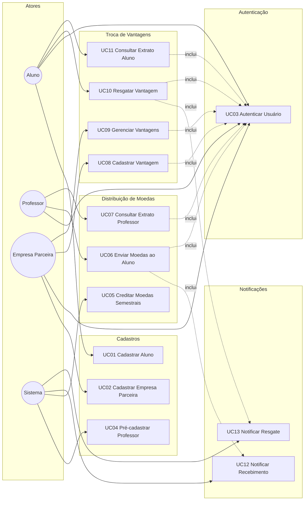

# Diagrama de Casos de Uso

## Visão geral

> Relação `<<include>>`: autenticação é pré-condição das operações; envio de moedas inclui notificação ao aluno; resgate inclui notificação a aluno e empresa.

---

## Descrição dos Casos de Uso

### UC01 — Cadastrar Aluno
| Item | Descrição |
|------|-----------|
| Ator principal | Aluno |
| Pré-condição | Instituição de ensino pré-cadastrada |
| Fluxo principal | 1. Informar Nome, E-mail, CPF, RG, Endereço, Instituição, Curso, Login e Senha 2. Sistema valida unicidade de e-mail/CPF 3. Aluno é persistido com saldo inicial 0 |
| Pós-condição | Aluno cadastrado e apto a autenticar |

### UC02 — Cadastrar Empresa Parceira
| Item | Descrição |
|------|-----------|
| Ator principal | Empresa Parceira |
| Pré-condição | — |
| Fluxo principal | 1. Informar dados cadastrais, login e senha 2. Sistema valida e persiste |
| Pós-condição | Empresa apta a autenticar e cadastrar vantagens |

### UC03 — Autenticar Usuário
| Item | Descrição |
|------|-----------|
| Atores | Aluno, Professor, Empresa Parceira |
| Pré-condição | Usuário cadastrado |
| Fluxo principal | 1. Informar login e senha 2. Sistema valida credenciais e identifica o perfil |
| Pós-condição | Sessão autenticada; acesso liberado às operações do perfil |
| Regra | Autenticação obrigatória para **todas** as operações do sistema |

### UC04 — Pré-cadastrar Professor
| Item | Descrição |
|------|-----------|
| Ator | Sistema (a partir da lista enviada pela instituição) |
| Fluxo | Cadastrar Nome, CPF, Departamento, Instituição, Login e Senha |
| Pós-condição | Professor vinculado à instituição/departamento |

### UC05 — Creditar Moedas Semestrais
| Item | Descrição |
|------|-----------|
| Ator | Sistema |
| Regra | +1.000 moedas por semestre; saldo acumulável |
| Pós-condição | Saldo do professor atualizado |

### UC06 — Enviar Moedas ao Aluno
| Item | Descrição |
|------|-----------|
| Ator principal | Professor |
| Inclui | UC03, UC12 |
| Pré-condição | Professor autenticado; saldo suficiente |
| Fluxo | 1. Selecionar aluno e valor 2. Preencher mensagem obrigatória (motivo) 3. Sistema debita professor, credita aluno e registra transação |
| Exceção | Saldo insuficiente ou mensagem vazia → operação rejeitada |

### UC07 — Consultar Extrato Professor
| Item | Descrição |
|------|-----------|
| Ator | Professor |
| Inclui | UC03 |
| Resultado | Saldo atual + lista de moedas enviadas (aluno, valor, mensagem, data) |

### UC08 — Cadastrar Vantagem
| Item | Descrição |
|------|-----------|
| Ator | Empresa Parceira |
| Inclui | UC03 |
| Fluxo | Informar Descrição, Foto e Custo (moedas); vincular à empresa |

### UC09 — Gerenciar Vantagens
| Item | Descrição |
|------|-----------|
| Ator | Empresa Parceira |
| Inclui | UC03 |
| Fluxo | Listar, editar ou remover vantagens da própria empresa |

### UC10 — Resgatar Vantagem
| Item | Descrição |
|------|-----------|
| Ator principal | Aluno |
| Inclui | UC03, UC13 |
| Pré-condição | Aluno autenticado; saldo ≥ custo |
| Fluxo | 1. Escolher vantagem 2. Sistema debita saldo 3. Gera cupom/código 4. Dispara notificações |
| Exceção | Saldo insuficiente → resgate rejeitado |

### UC11 — Consultar Extrato Aluno
| Item | Descrição |
|------|-----------|
| Ator | Aluno |
| Inclui | UC03 |
| Resultado | Saldo atual + moedas recebidas + trocas realizadas |

### UC12 — Notificar Recebimento de Moedas
| Item | Descrição |
|------|-----------|
| Ator | Sistema |
| Gatilho | Conclusão de UC06 |
| Resultado | E-mail ao aluno com valor, professor e mensagem |

### UC13 — Notificar Resgate
| Item | Descrição |
|------|-----------|
| Ator | Sistema |
| Gatilho | Conclusão de UC10 |
| Resultado | E-mail ao aluno (cupom + código) e e-mail à empresa (conferência) |
