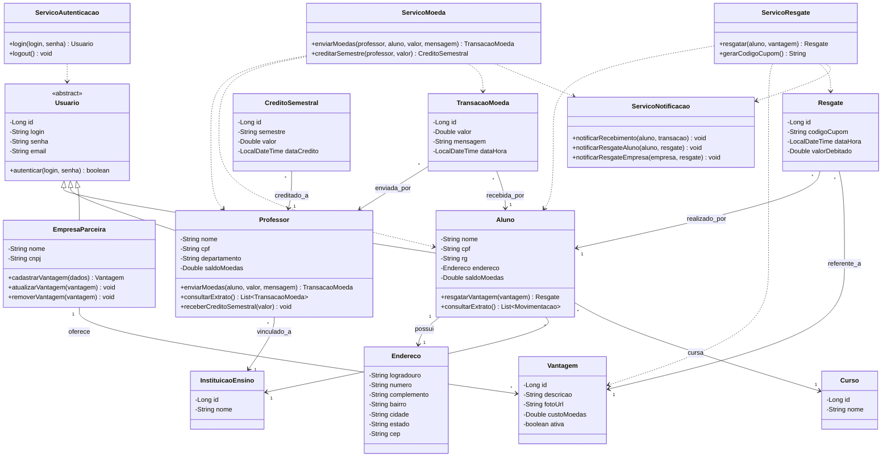

# Diagrama de Classes

Modelo de domínio alinhado à arquitetura MVC. Classes de **Controller** e **View** aparecem no diagrama de componentes; aqui o foco é o **Model** (entidades e serviços de negócio).

---

## Regras de negócio refletidas nas classes

| Regra | Onde aparece |
|-------|----------------|
| Login e senha obrigatórios | `Usuario` (+ `ServicoAutenticacao`) |
| Aluno: Nome, E-mail, CPF, RG, Endereço, Instituição, Curso | `Aluno`, `Endereco`, `InstituicaoEnsino`, `Curso` |
| Professor pré-cadastrado: Nome, CPF, Departamento, Instituição | `Professor` |
| 1.000 moedas/semestre, saldo acumulável | `Professor.saldoMoedas`, `CreditoSemestral`, `receberCreditoSemestral` |
| Envio exige saldo e mensagem | `ServicoMoeda.enviarMoedas` / `Professor.enviarMoedas` |
| Vantagem: descrição, foto, custo | `Vantagem` |
| Resgate debita saldo e gera cupom | `Resgate.codigoCupom`, `ServicoResgate` |
| E-mails de recebimento e resgate | `ServicoNotificacao` |

---

## Multiplicidades

| Relação | Cardinalidade |
|---------|---------------|
| Instituição → Alunos | 1 : N |
| Instituição → Professores | 1 : N |
| Curso → Alunos | 1 : N |
| Empresa → Vantagens | 1 : N |
| Professor → Transações enviadas | 1 : N |
| Aluno → Transações recebidas | 1 : N |
| Aluno → Resgates | 1 : N |
| Vantagem → Resgates | 1 : N |
