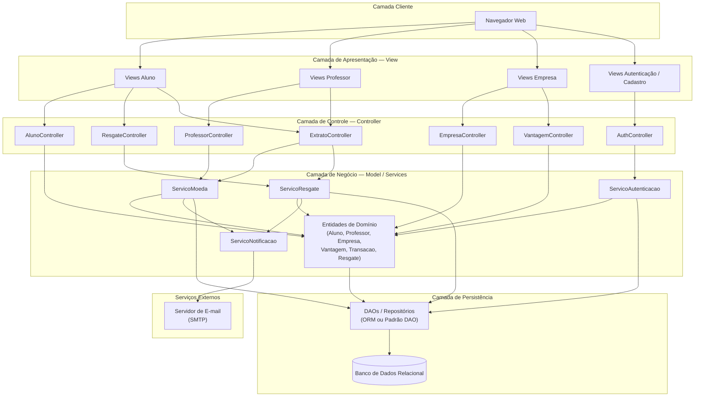

# Diagrama de Componentes

Arquitetura **MVC** com camadas de apresentação, controle, negócio, persistência e serviços externos (e-mail).

---

## Responsabilidades por camada

| Camada | Componentes | Responsabilidade |
|--------|-------------|------------------|
| **View** | Telas web por perfil | Formulários, listagens, extratos; não contém regra de negócio |
| **Controller** | Controllers por recurso | Recebe requisições HTTP, valida entrada básica, aciona serviços, devolve resposta à View |
| **Model / Services** | Serviços + entidades | Regras de negócio (saldo, mensagem, crédito semestral, cupom) |
| **Persistência** | DAO / ORM | CRUD e consultas; isola o SGBD |
| **Externo** | E-mail | Notificações de recebimento e resgate |

---

## Fluxos principais entre componentes

### Envio de moedas
`View Professor` → `ProfessorController` → `ServicoMoeda` → valida saldo/mensagem → persiste `TransacaoMoeda` → `ServicoNotificacao` → E-mail ao aluno

### Resgate de vantagem
`View Aluno` → `ResgateController` → `ServicoResgate` → debita saldo → gera cupom → persiste `Resgate` → `ServicoNotificacao` → E-mails ao aluno e à empresa

### CRUD Aluno / Empresa (Sprint 2)
`Views Cadastro` → `AlunoController` / `EmpresaController` → entidades → DAO/ORM → Banco

---

## Decisões de arquitetura (Sprint 1)

1. **MVC clássico** — separação clara View / Controller / Model, exigida pelo enunciado.
2. **Serviços de domínio** — regras de moeda, resgate e notificação fora dos Controllers, facilitando testes e alinhamento ao diagrama de classes.
3. **Persistência encapsulada** — ORM ou DAO (definição e implementação na Sprint 2); componentes acima não conhecem SQL.
4. **Notificação assíncrona/independente** — `ServicoNotificacao` como componente dedicado ao SMTP, desacoplado do fluxo de UI.
