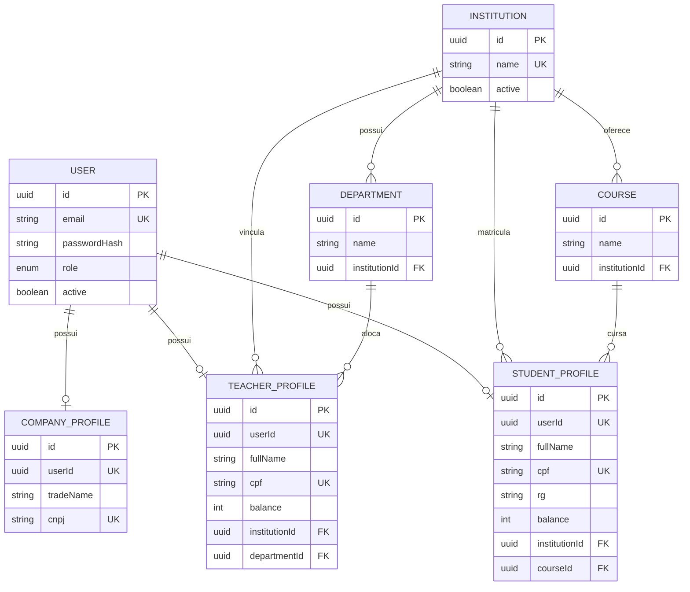

# MER — Sprint 2 (PostgreSQL)

Modelo alinhado ao `backend/prisma/schema.prisma`.

## Escopo CRUD Sprint 2

- **Aluno:** cadastro público (`POST /auth/register/student`) + consulta/edição/desativação autenticada
- **Empresa:** cadastro público (`POST /auth/register/company`) + consulta/edição/desativação autenticada
- **Professor:** apenas seed/pré-cadastro institucional
