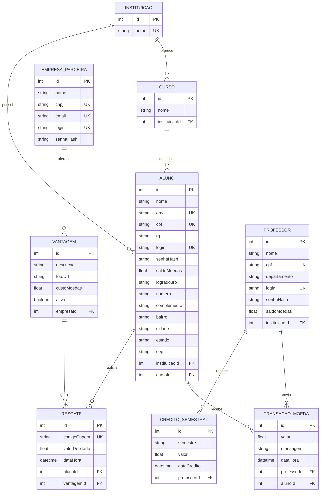

# Modelo Entidade-Relacionamento (MER)

Derivado do diagrama de classes da Sprint 1, com foco nas entidades necessárias aos CRUDs da Sprint 2 e preparando o domínio completo.

## Diagrama (Mermaid ER)

## Escopo implementado na Sprint 2

| Entidade | Persistida | CRUD nesta sprint |
|----------|------------|-------------------|
| Instituicao | Sim (seed) | Leitura (listagem para o formulário de aluno) |
| Curso | Sim (seed) | Leitura (listagem filtrada por instituição) |
| Aluno | Sim | **CRUD completo** |
| EmpresaParceira | Sim | **CRUD completo** |
| Professor, Vantagem, Transacao, Resgate, Credito | Schema preparado | Sprint 3 |

## Dicionário de dados (Sprint 2)

### INSTITUICAO
| Atributo | Tipo | Restrições |
|----------|------|------------|
| id | INTEGER | PK, autoincremento |
| nome | VARCHAR | NOT NULL, UNIQUE |

### CURSO
| Atributo | Tipo | Restrições |
|----------|------|------------|
| id | INTEGER | PK |
| nome | VARCHAR | NOT NULL |
| instituicaoId | INTEGER | FK → INSTITUICAO |

### ALUNO
| Atributo | Tipo | Restrições |
|----------|------|------------|
| id | INTEGER | PK |
| nome, email, cpf, rg | VARCHAR | email/cpf UNIQUE, NOT NULL |
| login, senhaHash | VARCHAR | login UNIQUE |
| saldoMoedas | REAL | DEFAULT 0 |
| logradouro, numero, bairro, cidade, estado, cep | VARCHAR | NOT NULL |
| complemento | VARCHAR | NULL |
| instituicaoId, cursoId | INTEGER | FK |

### EMPRESA_PARCEIRA
| Atributo | Tipo | Restrições |
|----------|------|------------|
| id | INTEGER | PK |
| nome, cnpj, email, login, senhaHash | VARCHAR | cnpj/email/login UNIQUE |

## Cardinalidades

- 1 Instituição → N Cursos / N Alunos / N Professores  
- 1 Curso → N Alunos  
- 1 Empresa → N Vantagens  
- 1 Professor → N Transações / N Créditos  
- 1 Aluno → N Transações / N Resgates  
